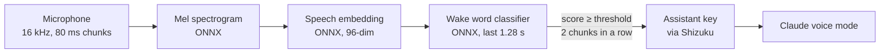

# Hey Claude for Android

**Say "Hey Claude" and Claude opens in voice mode, ready to listen. No button, no tap.**

Android lets you set Claude as your default digital assistant, but the only way to call it is to hold the side key. This app adds hands-free activation: it listens for a wake word on the phone itself and, when it hears it, triggers the assistant exactly the way the side key does.

- 🎙️ **Hands-free.** Say the wake word from across the room; Claude comes up already listening.
- 🔒 **Private by design.** No internet permission, nothing recorded, nothing leaves the phone.
- 🔋 **Light.** Listens only while the phone is unlocked and steps aside whenever another app needs the microphone.
- 🧠 **On-device detection.** A small neural network runs locally with ONNX Runtime, every 80 ms.

> **Unofficial project.** Not affiliated with, sponsored by, or endorsed by Anthropic. "Claude" is a trademark of Anthropic, PBC.

---

## Contents

- [How it works](#how-it-works)
- [Why Shizuku?](#why-shizuku)
- [Requirements](#requirements)
- [Setup](#setup)
- [Using it without Shizuku](#using-it-without-shizuku)
- [Tuning](#tuning)
- [Privacy and security](#privacy-and-security)
- [Battery](#battery)
- [Training your own wake word](#training-your-own-wake-word)
- [Building from source](#building-from-source)
- [Project structure](#project-structure)
- [Roadmap](#roadmap)
- [How this was built](#how-this-was-built)
- [Acknowledgements](#acknowledgements)
- [License](#license)

---

## How it works



Detection uses the [openWakeWord](https://github.com/dscripka/openWakeWord) model architecture, re-implemented in Kotlin on top of ONNX Runtime:

1. Every 80 ms, the newest 1280 audio samples (plus 480 samples of context) go through a mel spectrogram model.
2. The last 76 mel frames are turned into a 96-dimensional speech embedding by Google's speech embedding model.
3. The wake word model scores the last 16 embeddings (about 1.3 seconds of speech). A detection needs **two consecutive chunks** above the threshold, which filters out most one-off spikes from TV or music.

The Kotlin pipeline was checked against the reference Python implementation of openWakeWord on its test recordings and produces **bit-identical scores**.

When the wake word is detected, the app releases the microphone and presses the assistant key. Android then starts the default assistant, and Claude opens in the same listening overlay you get from the side key. While Claude (or any other app) is recording, the app stays quiet; it picks up again a few seconds after the microphone is free.

## Why Shizuku?

This was the hardest part of the project. Opening the Claude app is easy, but opening it **in voice mode** is not:

| Approach | Result |
|---|---|
| `Intent.ACTION_ASSIST` to the Claude app | Opens the text chat with the keyboard up |
| `Intent.ACTION_VOICE_COMMAND` | Not supported by the Claude app |
| `VOICE_ASSIST` on Claude's assistant activity | Opens the text chat |
| Claude's "Voice chat" launcher shortcut | Dynamic shortcut, not readable by other apps |
| `claude://` deep links | The voice shortcut goes through an activity that isn't exported |
| **Assistant key (`KEYCODE_ASSIST`)** | ✅ **Opens Claude in voice mode, exactly like the side key** |

Regular apps aren't allowed to inject key events, though. That's where **[Shizuku](https://github.com/RikkaApps/Shizuku)** comes in. Shizuku, by [RikkaW](https://github.com/RikkaW), lets an app run code with the same rights as `adb shell`, without root. It is started once through Android's own wireless debugging and then hands out access only to apps you approve.

How this app uses it:

- **Where:** [`shizuku/AssistKeyService.kt`](app/src/main/java/io/github/serifdrms/heyclaude/shizuku/AssistKeyService.kt) runs in a separate process that Shizuku starts. [`shizuku/ShizukuBridge.kt`](app/src/main/java/io/github/serifdrms/heyclaude/shizuku/ShizukuBridge.kt) tracks Shizuku's state, asks for permission and talks to that process.
- **What:** the helper exposes exactly **one** call, which runs `input keyevent KEYCODE_ASSIST`. It takes no arguments, so it can't be used to run anything else.
- **When:** only at the moment the wake word is detected (and when you press the test button).

Integration follows the official [Shizuku-API](https://github.com/RikkaApps/Shizuku-API) guide, using a `UserService` rather than the deprecated `newProcess`.

> Why not an accessibility service that taps Claude's voice button? It would need permission to read everything on screen, including your conversations. Shizuku lets the app do one fixed thing instead of watching the screen.

## Requirements

- Android 10 (API 29) or newer. Tested on a Samsung Galaxy A17 5G.
- The [Claude app](https://play.google.com/store/apps/details?id=com.anthropic.claude), set as the **default digital assistant**
- [Shizuku](https://play.google.com/store/apps/details?id=moe.shizuku.privileged.api) for voice mode (optional, see [below](#using-it-without-shizuku))
- A Wi-Fi network, only when starting Shizuku

## Setup

### 1. Make Claude the default assistant

**Settings → Apps → Choose default apps → Digital assistant app → Claude.**
Check that holding the side key now opens Claude.

### 2. Install and start Shizuku

1. Install **Shizuku** from Google Play.
2. Enable developer options: **Settings → About phone → Software information** and tap **Build number** seven times.
3. In Shizuku, choose **Start via Wireless debugging → Pairing**.
4. Open **Settings → Developer options → Wireless debugging → Pair device with pairing code**, then type the code into Shizuku's notification.
5. Back in Shizuku, tap **Start**. It should say Shizuku is running.

Pairing is a one-time step.

### 3. Set up Hey Claude

1. Install the app and open it.
2. Under **Setup**, grant microphone and notifications, turn off battery optimization, and allow the app in Shizuku.
3. Under **How to open Claude**, keep **Voice mode, like the side key** selected.
4. Tap **Test in 5 s**, go to the home screen and check that Claude opens listening.
5. Tap **Start listening** and say **"Hey Claude"**.

### After a reboot

Android doesn't let microphone services start by themselves, and Shizuku stops on reboot. So after restarting the phone:

1. Open Shizuku and tap **Start** (while connected to Wi-Fi).
2. Open Hey Claude and tap **Start listening**.

Once Shizuku is running you can turn Wi-Fi and wireless debugging off; it keeps working. **Don't disable Developer options or USB debugging**, as that stops Shizuku.

## Using it without Shizuku

Shizuku is optional. Choose **Text chat (works without Shizuku)** under **How to open Claude**, and also grant **Display over other apps**, which is what lets the app bring Claude up while you're in another app. The wake word then opens Claude's text chat instead of voice mode.

The app falls back to this automatically if Shizuku stops (for example after a reboot), so saying the wake word always opens Claude in some form.

## Tuning

- **Trigger threshold.** Lower values trigger more easily but may react to other speech. If the wake word is missed, lower it; if Claude opens by itself, raise it. The score bar shows live how close you get.
- **Pause after opening Claude.** The minimum time listening stays off after a detection. It also stays off for as long as another app is using the microphone.

## Privacy and security

- **No network access.** The manifest strips `INTERNET` and `ACCESS_NETWORK_STATE`, even if a dependency asks for them. Audio can't leave the phone through this app.
- **Nothing is recorded.** Audio lives in a single reusable 80 ms buffer. It is never written to disk or logged.
- **Listens only while unlocked.** The microphone is released when the screen turns off and reopened after unlock.
- **Steps aside for other apps.** The app doesn't reopen the microphone while any other app is recording. Android only reports that some recording is active; the app never learns which app it is or what it hears.
- **No screen access.** No accessibility service. The app can't see what's on screen.
- **Narrow privileged code.** The only code running with Shizuku's rights is the single fixed key press described above.
- **Pinned models.** Every bundled model is checked against a SHA-256 hash before it's loaded.
- **Minimal surface.** The service isn't exported, broadcasts are registered as not-exported, and backups and device transfers are disabled. The only exported component is Shizuku's provider, which only the system can call.

## Battery

Shizuku sleeps until it's needed and costs practically nothing. The detection pipeline takes about 1.9 ms per 80 ms chunk on a single desktop CPU core (about 2.4%); phone cores are slower, but it stays a small fraction of one core. Nothing runs while the screen is off.

## Training your own wake word

The bundled model was trained with openWakeWord's automatic training notebook on Google Colab (free T4 GPU, about 35 minutes of training). The upstream notebook doesn't run on current Colab anymore; [this pull request](https://github.com/dscripka/openWakeWord/pull/359) fixes it:

**[Open the fixed notebook in Colab](https://colab.research.google.com/github/Oreozisbored/openWakeWord/blob/modernize-training-notebook/notebooks/automatic_model_training.ipynb)**

Tips:

- Run the cells one at a time instead of "Run all", and set your phrase in step 5 before training.
- Use step 6 to listen to the synthetic voices before the 16 GB download. Non-English words usually need an English-style spelling.
- If step 3 fails with `undefined symbol: torch_exception_get_what_without_backtrace`, `torch` and `torchaudio` were installed in mismatched versions. Add a cell after step 3 with
  ```
  !{UV_BIN} pip install --python /content/py311 --reinstall "torch==2.8.0" "torchaudio==2.8.0" --index-url https://download.pytorch.org/whl/cu126
  ```
  then run step 3 again.
- Skip step 8 (TFLite); the app uses the `.onnx` file.

To add the model to the app, copy it into `app/src/main/assets/models/` and register it in [`ModelCatalog.kt`](app/src/main/java/io/github/serifdrms/heyclaude/wakeword/ModelCatalog.kt) with its SHA-256 hash (`Get-FileHash file.onnx -Algorithm SHA256` on Windows, `sha256sum file.onnx` on Linux and macOS).

## Building from source

1. Clone the repository and open it in Android Studio.
2. The project uses AGP 9.4, Kotlin 2.4 and Gradle 9.8, so the JDK bundled with a recent Android Studio works. If sync complains about the JVM, check **Settings → Build, Execution, Deployment → Build Tools → Gradle → Gradle JDK**.
3. Run the `app` configuration, or build an APK with **Build → Build App Bundle(s) / APK(s) → Build APK(s)**.

Unit tests for the detection pipeline run on the plain JVM:

```
./gradlew testDebugUnitTest
```

## Project structure

```
app/src/main/java/io/github/serifdrms/heyclaude/
├── audio/MicCapture.kt          microphone capture thread
├── launch/ClaudeLauncher.kt     opens Claude (voice via Shizuku, text as fallback)
├── service/ListenerService.kt   foreground service, screen lock and microphone sharing
├── service/ListenerState.kt     state shared with the UI
├── settings/AppSettings.kt      threshold, cooldown, launch method
├── shizuku/
│   ├── ShizukuBridge.kt         Shizuku status, permission and helper binding
│   └── AssistKeyService.kt      helper process: presses the assistant key
├── ui/HomeScreen.kt             Compose UI
└── wakeword/
    ├── FeatureExtractor.kt      streaming mel → embedding pipeline (pure Kotlin)
    ├── WakeWordDetector.kt      scoring, threshold and patience (pure Kotlin)
    ├── OnnxModel.kt             ONNX Runtime wrapper
    ├── ModelCatalog.kt          bundled models and their hashes
    └── WakeWordEngine.kt        loads and wires everything together
```

## Roadmap

- A second wake phrase in Turkish, trained with real voice recordings on top of synthetic speech
- A sound gate that skips the neural network while the room is silent, to save more battery
- "Hey GPT" / "Hey Gemini": switching the default assistant on the fly before pressing the assistant key

## How this was built

The full story, including every dead end on the way to voice mode, is in **[docs/DEVELOPMENT.md](docs/DEVELOPMENT.md)**.

## Acknowledgements

- **[openWakeWord](https://github.com/dscripka/openWakeWord)** by David Scripka: model architecture, feature models and training pipeline
- **[Shizuku](https://github.com/RikkaApps/Shizuku)** and **[Shizuku-API](https://github.com/RikkaApps/Shizuku-API)** by RikkaW: privileged access without root
- **[ONNX Runtime](https://github.com/microsoft/onnxruntime)** by Microsoft: on-device inference
- **[Piper](https://github.com/rhasspy/piper)**: the synthetic voices used for training
- **[@Oreozisbored](https://github.com/Oreozisbored)**: the updated Colab training notebook

## License

The code is released under the [Apache License 2.0](LICENSE).

The bundled `hey_claude.onnx` wake word model is released under [CC BY-NC-SA 4.0](https://creativecommons.org/licenses/by-nc-sa/4.0/), because part of its training data uses that license. Third-party components are listed in [NOTICE](NOTICE).
